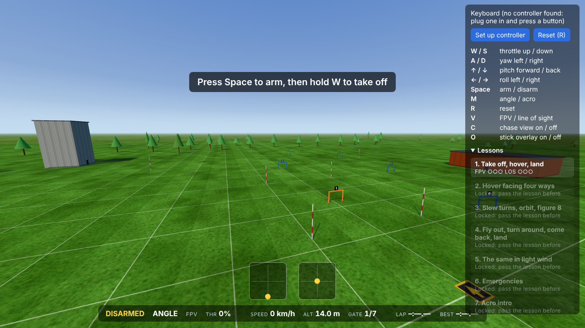

# FPV sim

A browser simulator for learning to fly an FPV drone before you own one. A 5-inch freestyle quad on an open field, flown with a game controller. No install: open the link.

**Play:** https://mickethegeek.github.io/fpv-sim/



## Connect a controller

**PlayStation controller (DualShock 4 or DualSense)**
1. Plug it in with a USB cable, or pair it over Bluetooth.
2. Open the link and press any button on the controller. Settings in the menu shows its name.
3. No setup needed. It flies in Mode 2:

| Control | Does |
|---|---|
| Left stick up / down | throttle (stick centre = about hover) |
| Left stick left / right | yaw (turn) |
| Right stick up / down | pitch (forward / back) |
| Right stick left / right | roll (left / right) |
| R1 | arm / disarm |
| L1 | angle mode / acro mode |
| △ | FPV view / line-of-sight view |
| Options | pause menu (Resume, Restart, Skip, Settings, Back to menu) |
| Share / Create | reset to the pad, straight away |
| D-pad, ✕, ◯ | in menus: move, select, back |

To arm: pull the left stick down, then press R1. This is the same safety rule as a real quad (no arming with the throttle up).

**A real radio over USB (BetaFPV LiteRadio and others)**
1. Switch the radio on and plug it in. It shows up as a joystick.
2. The setup screen opens by itself: move each stick when asked, then flip the arm switch.
3. The radio keeps its own saved setup, separate from the PlayStation controller. Its throttle is linear, as on the real quad.

Other gamepads with the standard layout work like the PlayStation one (RB arm, LB mode, Y view, View reset, Menu pause; A select, B back). "Set up controller" in Settings maps anything else. "Reset this controller" throws a saved setup away.

**No controller:** the keyboard works as a backup. The keys are listed in Settings (W / S throttle, A / D yaw, arrows pitch and roll, Space arm, Esc menu). Menus work with the arrows, Enter and Esc, or the mouse.

## How to play

The page opens on a menu: **Learn**, **Gates**, **Free fly**, **Theory**, **Stick patterns**, **Settings**. Nothing is locked: open any chapter, skip any part from the pause menu (Options or Esc), or go straight to the gates.

- **Learn.** Eight chapters. Each has up to four parts, all optional: **Learn** (short cards, each shown live in the sim with the real forces drawn as arrows), **Watch** (a test pilot flies the lesson, sticks on screen), **Check** (two or three quick questions) and **Try** (you fly it). ✕ or Enter goes to the next card, ◯ or Backspace back.
- **Theory** lists every card, to look one up again at any time.
- **Try.** The eight lessons take you from the first take-off to a "real-drone ready" badge: hover, hover facing all four ways, turns and a figure 8, fly out and come back, the same in wind, emergencies, a first taste of acro, and a final check. A lesson is passed after 3 good runs in a row. Lessons 1 to 4 are flown twice: through the camera (FPV) and standing on the ground watching the drone (line of sight).
- **Gates:** a 7-gate course with a lap timer. The orange gate is the next one. Your best lap is saved.
- **Free fly:** the same field with nothing extra on screen (no gate guide, no lap timer).
- **Angle mode** levels the quad when you let go. **Acro mode** does not: it holds the angle you leave it at, like a real FPV quad.
- **Quad** (Settings, under "Feel tuning"): *Trainer* is the same quad limited to 70 % power, the default. *5-inch freestyle* is full power.
- **Crash:** the quad goes back to the pad after a moment. R (or Share / Create on the controller) does the same at any time.
- Other keys: V view, C chase view, O stick overlay, M mode.

## Stick patterns

In the menu, next to Theory. Eight moves (hover, up and down, turn on the spot, fly forward, stop, nose toward you, banked turn, orbit), each with both sticks written out and flown live with the sticks on screen. Most are flown twice: once right, once with one part forgotten, so you see what goes wrong (snap the yaw and it jumps up; forget the throttle when you go forward and it sinks). In Try, the lesson's pattern shows as a small reminder; switch it off in Settings ("Pattern reminder"). Under the left stick the overlay shows the throttle value live: on a PlayStation stick a sideways push for yaw often moves the throttle too.

## Helpers

All off unless you ask for them, except the coaching line, which only appears after a failed lesson run.

- **Force arrows** (F, or Settings): the real forces drawn on the quad in any flight. Yellow: the thrust of each motor. Red: the weight. Blue: the velocity. They show in line-of-sight view (V) and chase view (C); in FPV the camera sits on the quad, so there is nothing to draw them on.
- **Coaching:** when a lesson run fails, the result card says why in one line, from that run's own data. For example: "You landed 2.3 m to the right of the pad: you held roll right for 1.6 s and never stopped the drift. There are no brakes: roll left briefly, then level."
- **Camera tilt** (Settings): in Learn the camera is tilted up 12°, a beginner value, and 25° in Gates and Free fly. Move the slider and your value is used everywhere; "Camera tilt back to default" undoes it.
- **Stick overlay** (O, or Settings): where the sticks are right now.

## Settings

- **Graphics:** High or Low. The frame rate is shown next to it. If it is under 60, choose Low.
- **Stick overlay, View, Force arrows, Camera tilt:** see Helpers above.
- **Feel tuning:** rates, expo, responsiveness, floatiness, throttle at stick centre, deadzone. "Reset to default" goes back to the sourced values.
- Everything is saved in the browser, per computer.

Link options: `?learn` (or `?learn=wind`), `?gates` and `?free` skip the menu and start there, `?preset=freestyle` picks the full-power quad, `?quality=low`.

## How real is it

Every flight number comes from a published source or is marked UNSOURCED: Betaflight's default rates and tilt limit, bench thrust tables for 2207 motors on 6S, a measured motor time constant, measured rotor drag. The list, with links and the sim's measured values, is in [`docs/feel.md`](docs/feel.md) and [`docs/physics.md`](docs/physics.md). What is still open is in [`REPORT.md`](REPORT.md).

Physics runs at 1000 steps per second, whatever the frame rate.

## Run it yourself

No build step. Any static file server works:

```
node tools/serve.mjs 8080      # then open http://localhost:8080
npm test                       # unit tests (physics, controller, course, lessons, theory, coaching)
node test/flight.mjs out       # flies the sim in Chrome, screenshots to proof/out/
```

Layout: `src/` (physics, flight controller, input, lessons, theory cards and their demos, scene), `test/`, `docs/`, `proof/` (screenshots from the automated flights, one folder per milestone; `proof/final/` is the last full run), `vendor/` (three.js r170, the only library).
